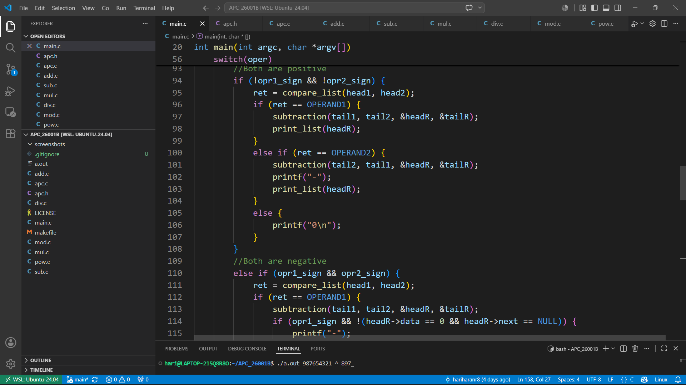
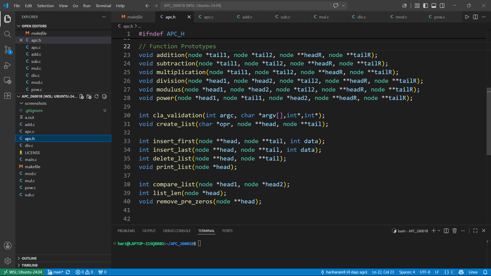
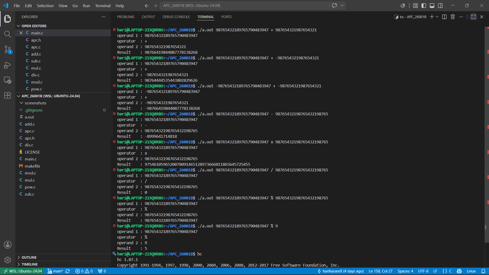

# 🧮 Arbitrary Precision Calculator (APC in C)


---

## 📌 Overview
The **Arbitrary Precision Calculator (APC)** is a command-line software application developed in C designed to overcome standard integer data type limits (such as `int`, `long`, or `long long int`) by processing numbers of virtually infinite size. 

By implementing a bidirectional linked list architecture, the system stores and manipulates massive numerical operands digit-by-digit as individual nodes, ensuring complete structural memory safety through dynamic allocation. The arithmetic engine fully supports signed operations for Addition, Subtraction, Multiplication, Division, Modulus, and Exponentiation, accurately resolving sign rules and mathematical precedence while automatically pruning formatting abnormalities like leading zeros directly from the memory stream.

---

## 🚀 Features

* ➕ **Complete Signed Arithmetic Suite**:
  * **Addition (`+`)**: Reverse-traversal ripple-carry addition across bidirectional nodes.
  * **Subtraction (`-`)**: Magnitude-aware borrow calculation with dynamic sign inversion.
  * **Multiplication (`x` or `X`)**: Positional shift-and-add accumulator multiplication.
  * **Division (`/`)**: Digit-by-digit repeated subtraction long division engine.
  * **Modulus (`%`)**: Chunked long division remainder extraction engine.
  * **Power (`^`)**: Iterative multi-node exponentiation evaluation.
* ⚖️ **Full Signed Value Support**: Accurately tracks, assigns, and evaluates signed inputs (`+` or `-`) across all operations based on magnitude comparisons and mathematical sign precedence.
* 🧹 **Automated Leading Zero Normalization**: Strips redundant prefix zeros (converting e.g., `000012` to `12`) during input parsing, intermediate calculations, and final result rendering.
* 🛡️ **Zero-Trap Exception Guarding**: Actively traps division by zero (`x / 0`) and modulo by zero (`x % 0`), emitting descriptive error diagnostics rather than crashing.
* ⚡ **Memory-Safe Pipeline Optimization**:
  * Replaces rigid static buffers with dynamic node allocations (`malloc`) sized to the exact digit count.
  * Rigorous heap boundary cleanup using pointers and `free()` prevents memory leaks.
* 🚫 **Strict Command-Line Validation**: Enforces exact argument formatting, valid operator symbols, and digit-only constraints across numerical operands.

---

## 🛠️ Tech Stack

* **Language**: C
* **Concepts Used**:
  * Custom Doubly Linked Lists (`struct node` with `prev`, `data`, and `next` pointers)
  * Dynamic Memory Allocation (`malloc`, `free`)
  * Pointers & Bidirectional Traversal
  * Input Sanitization & String Parsing (`isdigit`, ASCII conversion)
  * Modular Multi-File Architecture & Compilation (`Makefile`, GCC)

---

## 📂 Project Structure

```text
├── main.c        → Application gateway, operator dispatching & sign resolution
├── apc.c         → CLI validation, node creation, list comparisons & memory freeing
├── apc.h         → Data structure maps, operational macros & function prototypes
├── add.c         → Ripple-carry bidirectional addition engine
├── sub.c         → Magnitude-aware borrow subtraction engine
├── mul.c         → Shift-and-add multi-node multiplication engine
├── div.c         → Chunked repeated-subtraction long division engine
├── mod.c         → Long division remainder collection engine
├── pow.c         → Multi-node iterative exponentiation engine
└── makefile      → Multi-file automated GCC build and clean rules
```
---
## ⚙️ How It Works
1. **Parses & Validates Execution Arguments:**
   - Verifies that the program call contains exactly four arguments (`./a.out <operand1> <operator> <operand2>`).
   - Identifies leading unary signs (`+` / `-`) on both operands to set algebraic sign flags.
   - Scans remaining operand strings using `isdigit()` to guarantee strictly valid numerical digits.
2. **Builds Dynamic Node Chains:**
   - Converts numeric string characters into integer digits via ASCII offset conversion (`char - '0'`).
   - Populates two doubly linked lists dynamically using `malloc()`, linking each digit with `prev` and `next` pointers.
3. **Normalizes Operand Representation:**
   - Traverses both doubly linked lists from their heads using `remove_pre_zeros()` to strip redundant leading zero nodes (e.g., converting `000045` into `45`).
4. **Evaluates Operand Magnitudes:**
   - Compares total list node counts using `compare_list()`.
   - In equal-length scenarios, steps node-by-node from the head to detect higher numerical magnitude (`OPERAND1`, `OPERAND2`, or `SAME`).
5. **Executes Target Arithmetic Engines:**
   - **Addition (`+`):** Traverses backward from `tail`, computes values with carry propagation, and prepends digits into the result list.
   - **Subtraction (`-`):** Compares magnitudes, subtracts smaller operand nodes from larger operand nodes backward from `tail`, handles borrowing, and applies resultant sign rules.
   - **Multiplication (`x` or `X`):** Emulates column multiplication by evaluating partial products, shifting positional zeroes, and accumulating totals with `addition()`.
   - **Division (`/`):** Processes the dividend digit-by-digit into an active working block, performing repeated subtractions against the divisor to assemble quotient digits.
   - **Modulus (`%`):** Executes long division chunking where the remaining working block after all dividend digits are exhausted forms the remainder list.
   - **Power (`^`):** Reads the exponent list into an execution counter and computes exponentiation through iterative list multiplications.
6. **Renders Result & Reclaims Memory:**
   - Outputs operands, operator, and the final signed result list.
   - Traverses all allocated lists (`head1`, `head2`, and `headR`) using `delete_list()` to release every node back to the heap via `free()`.

---

## 🔐 Validation & Safety Highlights

- **Strict Command-Line Argument Verification:**
  - **Argument Count Enforcement:** Enforces a rigid structure demanding exactly **4 arguments** (`./a.out operand1 operator operand2`). Missing or floating parameters immediately halt execution with usage help prompts.
  - **Operator Syntax Verification:** Restricts operator inputs strictly to supported single characters (`+`, `-`, `x`, `X`, `/`, `%`, `^`), emitting clear diagnostic error listings if invalid tokens are entered.
- **Operand & Data Stream Guards:**
  - **Character-Level Digit Verification:** Iterates through operand strings using `isdigit()`, intercepting invalid non-numeric characters before memory allocation begins.
  - **Leading Unary Sign Processing:** Safely isolates leading `+` and `-` characters while rejecting bare sign tokens that lack following numeric digits.
  - **Pre-Zero Sanitization:** Runs `remove_pre_zeros()` across both input lists and intermediate results, preventing miscalculated length checks during magnitude comparisons.
- **Robust Mathematical & Memory Handling:**
  - **Zero-Condition Exception Handling:** Intercepts division by zero (`ERROR: Division by zero is infinite!`) and modulus by zero (`ERROR: Modulus by zero is undefined!`), preventing invalid mathematical execution.
  - **Dynamic Heap Memory Safeguards:** Checks pointer validity following dynamic allocation via `malloc()`.
  - **Leak-Proof Heap Teardown:** Employs `delete_list()` routines to traverse each node sequentially, unlinking bidirectional pointers and freeing memory buffers across all active lists before termination.

---

## 🧠 Key Learnings
- **Bidirectional List Architecture:** Designed doubly linked lists allowing both forward traversal for output rendering and division, and reverse traversal from `tail` for ripple-carry addition and borrow subtraction.
- **Software-Emulated Positional Arithmetic:** Implemented arbitrary-precision mathematical operations from scratch in C without relying on third-party math packages.
- **Dynamic Memory Lifecycle Tracking:** Managed dynamic node creation and immediate deallocation inside nested loops (such as multi-digit multiplication and long division accumulators) without dangling pointers.
- **Algebraic Sign Resolution:** Engineered mathematical state tracking to route mixed-sign addition and subtraction operations through complementary arithmetic engines.
- **Defensive CLI Engineering:** Built resilient input sanitization filters to prevent segmentation faults caused by improper arguments, unexpected non-numeric characters, or arithmetic edge cases.

---

## 📸 Screenshots

### Main() & CLI Validation:


### Header File:


### Output:


---

## 📈 Future Enhancements
- **Dynamic Floating-Point Support:** Extend node structures to handle arbitrary precision floating-point decimals with floating radix markers.
- **Logarithmic Exponentiation:** Upgrade the power engine from linear accumulation ($O(N)$) to binary exponentiation ($O(\log N)$).
- **Interactive REPL Mode:** Implement an interactive terminal session allowing continuous calculations without restarting the executable.

---

## 🙌 Author
**Hariharan R**  
🎓 2025 Graduate | Electronics and Communication Engineering  
🔧 Aspiring Embedded Systems & Firmware Engineer  
💻 Strong in C Programming, Data Structures & Dynamic Memory Management  
⚙️ Interested in Embedded Systems, Microcontrollers & Low-Level Development  

---

## 🌟 Support
If you like this project:

⭐ Star this repository  
🍴 Fork and improve it  
📢 Share with others  

---

## 📬 Contact

- 📧 Email: hariharanrbe@gmail.com
- 💼 LinkedIn: https://www.linkedin.com/in/hariharanrbe/

---

## 🏷️ Tags
`C Programming` `Data Structures` `Doubly Linked List` `Arbitrary Precision` `BigInt Calculator` `Memory Management` `Algorithms` `Low-Level Development`
